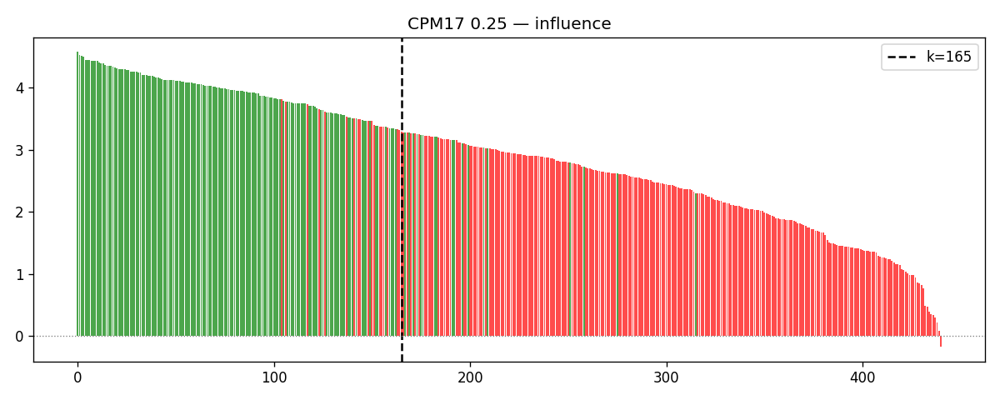
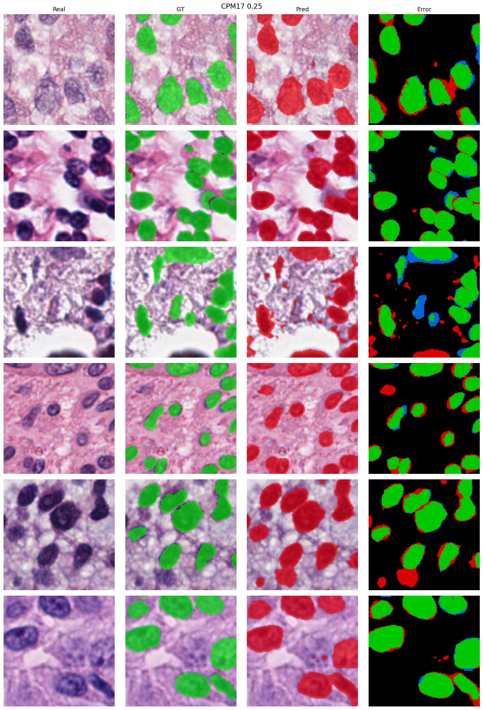

# DenoRank: Gradient-Free Synthetic Sample Selection for Low-Label Nuclei Segmentation via Diffusion Denoising Residuals

<p align="center">
  
  
  
  
</p>

<p align="center"><i>Self-directed research project · Souvik Pramanik</i></p>

---

Synthetic H&E images from a diffusion model can stretch a small labelled set, but not every
synthetic sample helps the downstream segmenter. Influence-based selection (TracIn) can tell the
good from the harmful, but it needs per-sample gradients through the segmenter, which is slow and
tied to one particular model.

**DenoRank** ranks synthetic images with a **gradient-free score computed from the denoising
residual of a LoRA-finetuned Stable Diffusion UNet**. It needs only **3 forward passes** per
image and **no segmenter gradients**.

## Highlights

- **Gradient-free score.** Rank synthetic H&E images by their ε-prediction residual at three
  timesteps. No segmenter gradients, no per-sample backward passes.
- **Theory link.** The ε-prediction loss is connected to TracIn influence, tying generator
  likelihood to downstream segmentation utility.
- **Agrees with TracIn.** Strong rank agreement with TracIn (Spearman ρ = −0.71 to −0.92,
  p < 0.0001) in **8 of 9** settings across multiple microscopic datasets.
- **Failure regime identified.** Below 10% labels the score degrades; the cause is unstable
  ensemble reference gradients (analysed in the project).
- **Strong low-label accuracy.** Dice of **0.78 on MoNuSeg** and **0.80 on CPM-17** at 25% labels.

## Method

```
 labelled patches ──► mask deformation ──► SD inpainting (LoRA-finetuned) ──► synthetic H&E pool
                                                                                   │
                       ┌───────────────────────────────────────────────────────────┤
                       ▼                                                           ▼
        denoising residual  r(x)                                     TracIn influence (reference only)
        3 UNet forward passes, no segmenter                          needs segmenter gradients
                       │                                                           │
                       └──────────── Spearman rank agreement ◄────────────────────┘
                       ▼
        keep top-k lowest-residual samples ──► train segmenter on real + selected synthetic
```

For a synthetic image `x` with VAE latent `z`, noise `ε ~ N(0, I)` and timesteps `T = {100, 300, 500}`:

```
r(x) = (1/|T|) · Σ_{t∈T} ‖ ε_θ(z_t, t, c) − ε ‖²        (lower = better)
```

`ε_θ` is the LoRA-finetuned UNet. A low residual means the sample is likely under the
real-data distribution the generator was adapted to, which is why it tracks high TracIn influence.

The downstream segmenter is a plug-in. A plain U-Net ships as the default and any module mapping
`(B,3,H,W) → (B,1,H,W)` logits can be registered (see [Custom segmenter](#custom-segmenter)).

## Installation

```bash
git clone https://github.com/souvikpramanik-medimg/DenoRank.git
cd DenoRank
conda create -n denorank python=3.10 -y
conda activate denorank
pip install -r requirements.txt
pip install -e .
```

A CUDA GPU is required for generation, LoRA training and scoring (Stable Diffusion in fp16).

## Datasets

| Dataset | Task | Link |
|---------|------|------|
| MoNuSeg | Multi-organ nuclei | [Grand Challenge](https://monuseg.grand-challenge.org/) |
| CPM-17  | Nuclei, 4 cancer types | [HoVer-Net data page](https://github.com/vqdang/hover_net) |

Expected structure (a `validation/` split is optional; if missing, 20% of train tiles are held out):

```
data/
├── CPM17/
│   ├── train/       {images/, masks/}
│   ├── validation/  {images/, masks/}
│   └── test/        {images/, masks/}
└── MoNuSeg/
    ├── train/       {images/, masks/}
    └── test/        {images/, masks/}
```

Masks are binarised foreground/background. Tiles are resized to `--tile` (default 512) and cut into
`--patch` × `--patch` (default 128) patches. CPM-17 images are ~500–600 px, so 512/128 avoids upscaling.

## Usage

```bash
# CPM-17 at 5% / 10% / 25% labels
python -m denorank.run_experiment \
  --dataset CPM17 --data_root data/CPM17 \
  --fractions 0.05 0.10 0.25 --seeds 42 --out_dir runs

# or
bash scripts/run_cpm17.sh
```

| Argument | Default | Description |
|---|---|---|
| `--fractions` | 0.05 0.10 0.25 | Fractions of labelled training tiles |
| `--seeds` | 42 | Random seeds |
| `--tile` / `--patch` | 512 / 128 | Tile size and patch size |
| `--segmenter` | unet | Registered segmenter name |
| `--den_unet` | lora | ε-predictor for the score: `lora` (fine-tuned) or `base` (pretrained) |
| `--time_budget_hours` | 0 | Stop launching new work after this budget (0 = unlimited) |

Everything is cached under `runs/<dataset>_frac<f>_seed<s>/` (synthetic pool, reference ensemble,
scores, influences, trained arms), so an interrupted sweep resumes where it stopped.

### Training arms compared

| Arm | Synthetic samples added |
|---|---|
| `real_only` | none |
| `all_syn` | whole pool |
| `random`, `random_k{k}` | random subset (50% / k) |
| `mean`, `min`, `mean_k{k}` | ensemble-evidence baselines (consistency, epistemic uncertainty) |
| `influence_topk` | top-k by TracIn influence (needs segmenter gradients) |
| **`den_topk`** | top-k by lowest denoising residual (k from the influence gap) |
| **`den_topk_fixed`** | lowest-residual 50%, fully gradient-free (no influence needed to pick k) |

### Outputs

```
runs/
├── results.csv, results_aggregated.csv       # Dice / IoU / HD95 per arm
└── CPM17_frac0.25_seed42/
    ├── rank_agreement.csv / .png             # Spearman ρ vs TracIn
    ├── influence_scores.png
    ├── predictions_den_topk.png
    └── scores.npz, influence.npy, synthetic.pt, *.pt
```

Summarise: `python -m denorank.summarize runs/results.csv`

### Custom segmenter

```python
from denorank.models import register_segmenter
register_segmenter("mynet", lambda base=32: MyNet(base))
# python -m denorank.run_experiment ... --segmenter mynet
```

## Results

| Dataset | Labels | Dice |
|---|---|---|
| MoNuSeg | 25% | **0.78** |
| CPM-17  | 25% | **0.80** |

Rank agreement between the denoising residual and TracIn: Spearman ρ = −0.71 to −0.92
(p < 0.0001) in 8 of 9 settings. Below 10% labels the agreement breaks down, because the ensemble
reference gradients that TracIn depends on become unstable with so few labelled patches.

## Qualitative Results

All figures below are for **CPM-17 at 25% labels**.

### Influence scores of synthetic samples
Green = selected, red = discarded; the dashed line marks the chosen k.

<p align="center">
  
</p>

### Nuclei segmentation
Columns: real image, ground truth, prediction, error map (green = TP, red = FP, blue = FN).

<p align="center">
  
</p>

## Project Structure

```
DenoRank/
├── denorank/
│   ├── data/dataset.py          # tiles → patches, labelled-subset sampling, dataset
│   ├── models/segmenter.py      # pluggable segmenter registry (default: U-Net)
│   ├── generation/
│   │   ├── lora.py              # LoRA fine-tuning of the SD UNet
│   │   └── synthesize.py        # mask deformation + mask-conditioned generation
│   ├── scoring/
│   │   ├── denoising.py         # gradient-free denoising-residual score
│   │   ├── tracin.py            # TracIn influence (reference)
│   │   ├── ensemble.py          # ensemble evidence baselines
│   │   ├── copy_guard.py        # near-duplicate filter
│   │   └── agreement.py         # Spearman rank agreement
│   ├── selection.py             # top-k rules, influence-gap k, arm construction
│   ├── engine.py                # segmenter training / evaluation
│   ├── pipeline.py              # end-to-end run
│   ├── run_experiment.py        # CLI
│   └── summarize.py
├── assets/                      # figures used in this README
├── scripts/                     # run_cpm17.sh, run_monuseg.sh
├── tests/
├── demo.ipynb
├── requirements.txt · setup.py · CITATION.cff · LICENSE
```

## Limitations

- Below ~10% labels the score loses agreement with TracIn (see above).
- Selection quality depends on the generator being adapted to the target stain/domain.
- Requires a GPU with enough memory for Stable Diffusion in fp16.

## Acknowledgements

Built on [Stable Diffusion](https://github.com/CompVis/stable-diffusion),
[🤗 Diffusers](https://github.com/huggingface/diffusers), [PEFT](https://github.com/huggingface/peft),
[LoRA](https://arxiv.org/abs/2106.09685), [DDPM](https://arxiv.org/abs/2006.11239) and
[TracIn](https://arxiv.org/abs/2002.08484).

## License

MIT. See [LICENSE](LICENSE).
